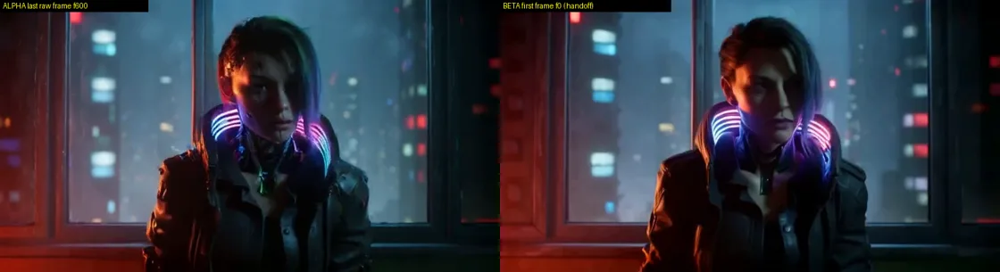
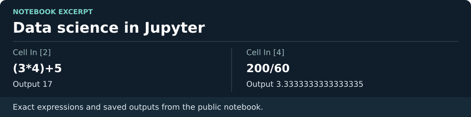
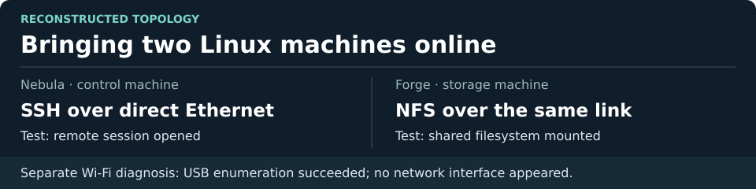
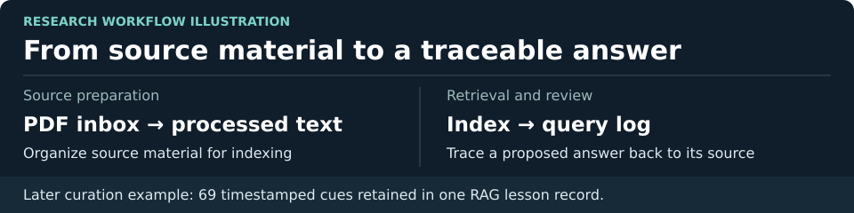
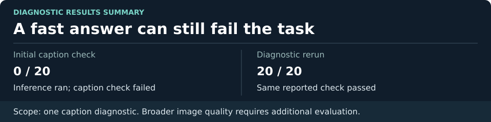
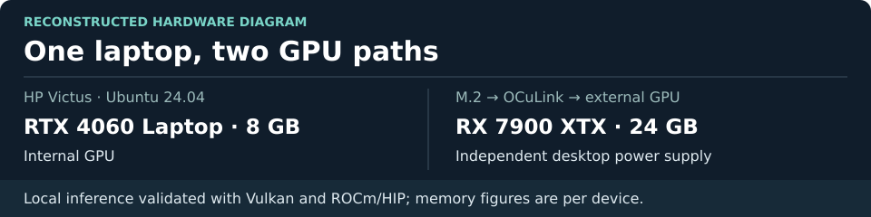
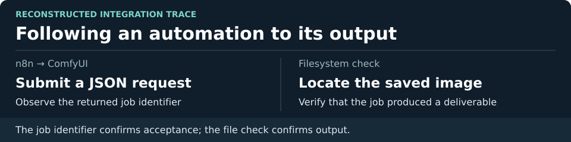

# Lawrence King

**Founder of Visual Story Factory | Applied AI engineering · Workflow automation · Multimodal evaluation**

Before AI, I made hip-hop, organized local concerts, and worked with video. That’s where I learned to listen for a bad mix and notice when a cut breaks a scene. Those instincts still drive my engineering. A render can finish successfully and still deliver a shot I would never show an audience.

## Technical capabilities

| Capability | Evidence from my projects |
|---|---|
| **API integration and workflow orchestration** | Connected n8n to ComfyUI with JSON, tracked asynchronous jobs by ID, and verified the saved output. |
| **Input validation and regression testing** | Reviewed positive and negative test cases for input contracts and GPU readiness. Four malformed queue responses exposed a separate polling defect. The archived pilot suite recorded 377 passing tests and 260 warnings. |
| **Fault recovery and end-to-end testing** | Verified that a restarted dispatcher reused a completed shot and finished the sequence. Checked final frame count, duration, and audio against acceptance criteria. |
| **Multimodal evaluation and release decisions** | Investigated a failed image-caption diagnostic in Shumai. On Dragon Forge, I accepted restart recovery and held creative sign-off when audio and visual continuity still needed work. |
| **GPU inference and Linux systems integration** | Ran a 27B-class model locally, validated Vulkan and ROCm/HIP inference on Ubuntu, and connected Linux machines using SSH and NFS. AMD ROCm Certified Associate. |
| **Permission-aware retrieval for RAG** | My VSF project exercised PostgreSQL and pgvector top-k retrieval with permission filtering and reranking. A story fixture caught a concealed fact reaching the wrong character. The project recorded 48/48 fault-matrix cases passing after repairs. |
| **SQL and database reliability** | My commerce tooling project validated the same application against SQLite and PostgreSQL. The merged milestone recorded 123 SQLite tests, 110 PostgreSQL behavioral tests, and 32 checks covering access controls, migrations, and backup/restore. All passed on test data. |
| **Continuous integration and local deployment** | Four GitHub Actions checks passed on the commerce milestone, covering Python, .NET, extension validation, and secret/schema scanning. Separately, I accepted a pinned Shumai container release after deployed-image checks, with a rollback image retained and known performance misses recorded. |

*Dragon Forge pilot evidence. The left image is the last frame of one shot; the right is the opening frame of the next.*

[Read the engineering release review](portfolio/engineering-review.md) · [Inspect the original notebook](https://github.com/Lawrenceckingjr/DataScienceEcosystem/blob/main/DataScienceEcosystem.ipynb)

## How I lead one project across a phone, a laptop, and multiple AI tools

On Visual Story Factory, I use **ChatGPT** to work through design decisions, **Claude Code** to implement a bounded change, and **Codex** to challenge the result against the acceptance criteria. **Visual Studio Code** is where I inspect the project on my laptop. I own the decision about what ships.

**Phone Mode** lets me review a short handoff between sessions: what changed, what evidence supports it, and which decision needs me. **Laptop Mode** gives me the detail behind that handoff: I can inspect the diff, rerun a check, or play the actual output. Both views answer the same question: *what evidence would make me accept this change?*

In the **Dragon Forge** pilot, the restart record showed that the dispatcher resumed without regenerating the first shot. The finished video told a different part of the story: two audio tracks were below the required floor. I could accept the recovery behavior while holding the audio work open. [See the checks and the release decision.](portfolio/engineering-review.md)

### Custom skills I built for my own work

| Skill | What it lets me do |
|---|---|
| **Handoff Prompt (HOP)** | Move a long-running project into a fresh session or onto another device with the last verified result, open questions, and next decision in hand. I can pick up the work without reconstructing a week of conversation. |
| **Clip Knowledge Curator (CKC)** | Turn a technical clip into a reference I can revisit. When a build raises a question I studied weeks ago, I can jump back to the relevant moment and check the source before applying the lesson. |

I also use a **Greenlight** convention across tools. I can explore a proposal from my phone, narrow its scope, and authorize a specific piece of work when I’m ready. That keeps design discussions useful while giving implementation and review a clear starting point.

### June 2025 · Data science in Jupyter

One of my earliest public artifacts is [DataScienceEcosystem](https://github.com/Lawrenceckingjr/DataScienceEcosystem), a Jupyter notebook from my data science studies. I keep it here because it shows the starting point for the work below.

### October 2025 · Getting two machines to work together

My first attempt to connect my Nebula and Forge machines over SSH returned “No route to host.” I got the direct Ethernet link working, verified remote access, and mounted an NFS share so one machine could use files on the other. I also traced a separate Linux Wi-Fi problem: the system detected the USB wireless adapter, but the networking tools had no usable interface. Learning to separate a routing failure from a driver problem mattered later when my AI jobs began spanning devices.

### February 2026 · Organizing AI research on Windows

On Windows 11 Pro, I set up **LumaRoleRAG**, a research workspace for studying image and video models. I organized source PDFs, processed text, an index, and query logs so I could trace an answer back to the material I was studying. This was an early step from using AI to answer questions toward designing how a tool should support an investigation.

### September 2026 · Finding a bottleneck at 10,000 scenes

In an AI-assisted VSF engineering project, I held a scene-write benchmark to its original **250 ms median target**. The first 10,000-scene run missed it at **879.5 ms**. After repair, a clean rerun measured **153.9 ms median** and **218.7 ms at the 95th percentile**. SQL checks counted the 10,000 scenes back out of the test database. These figures describe a controlled benchmark on disposable data.

### October 2026 · Building a local AI review desk

With **Shumai**, I brought media uploads, viewing, comments, and local model chat into one review desk. Getting a model to respond quickly was only half the job. An image-caption check scored **0/20** even though inference was running. I investigated the failure and got a diagnostic run to **20/20** on that check. That experience changed what I measure: latency tells me how long an answer took; a task-specific check tells me whether the answer helped.

### October–November 2026 · Putting a desktop GPU to work on a laptop

I connected a **24 GB Radeon RX 7900 XTX** to an HP Victus laptop through an **M.2-to-OCuLink eGPU link** with its own desktop power supply. The laptop also carries an **8 GB RTX 4060**. On Ubuntu 24.04 LTS, I validated local inference through Vulkan and ROCm/HIP, checked the hardware under load, and ran a 27B-class language model locally. One experimental ROCm run of a quantized 27B model recorded **914 prompt tokens/s** and **32.8 generated tokens/s**. I earned the **AMD ROCm Certified Associate** credential in November.

### November 2026 · From automation to filmmaking

**Workflow automation.** My first recorded run of this integration was in October 2025. I connected n8n to ComfyUI with a JSON request, captured the returned job ID, and checked that the image was actually saved. That last check is the one I care about: a service accepting a request and a user receiving a deliverable are two different events.

**Dragon Forge.** In one local run, my mixed-GPU workflow assembled three 10-second shots into a 30-second sequence at 60 fps in under 16 minutes. A later pilot demonstrated restart recovery: after the dispatcher stopped, it recognized the completed first shot and continued with the next two. I could also trim the assembled sequence without paying the compute cost of generating it again.

**What I’m working on now.** A technically valid video can still lose a character’s likeness between cuts. I’m testing how to preserve faces and wardrobe across shots, and how to distinguish intentional quiet from unusably low audio. I review both the decoded media and the scene itself before I call a take good.

[Connect with me on LinkedIn](https://www.linkedin.com/in/lawrence-king-22691459/)
